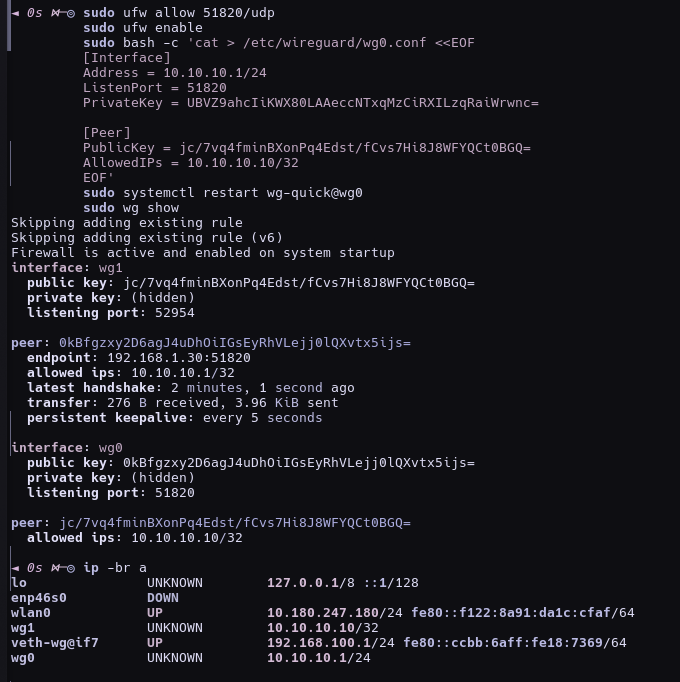
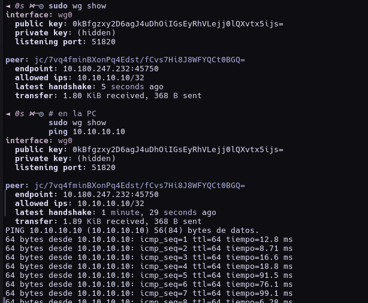
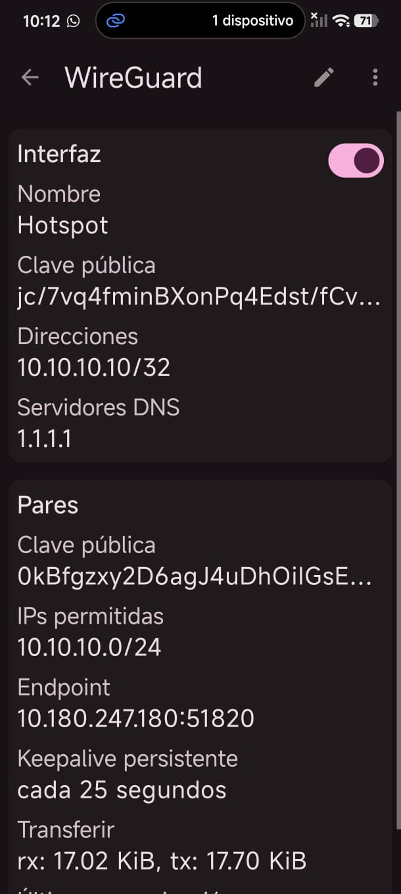
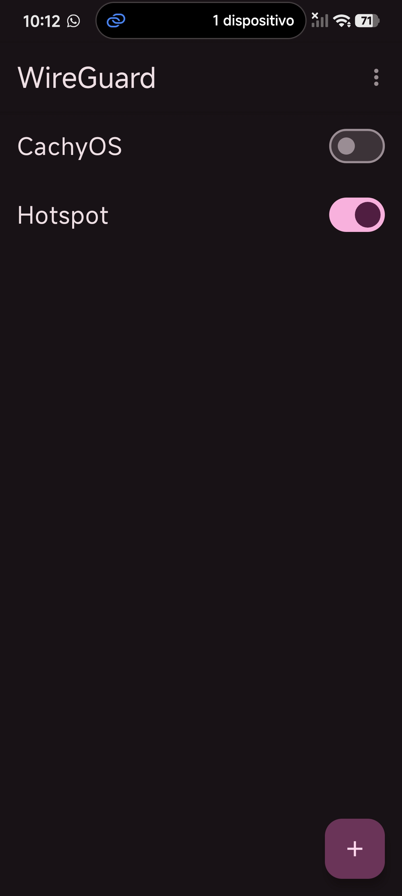

# PRÁCTICA 4  
## TALLER DE SISTEMAS OPERATIVOS  
### Creación de una Red Privada Virtual (VPN)

---

**Institución:** _________________________________  
**Carrera:** Ingeniería en Sistemas Computacionales / afín  
**Materia:** Taller de Sistemas Operativos  
**Alumno:** _________________________________  
**No. de control:** _________________________________  
**Grupo:** _________________________________  
**Fecha:** 12 de noviembre de 2026  

---

## 1. Objetivo

Implementar y verificar una Red Privada Virtual (VPN) en un sistema operativo Linux moderno, permitiendo la comunicación segura entre un servidor (PC) y un cliente (dispositivo móvil), utilizando un protocolo actual y soportado.

En esta práctica se sustituyó el servicio original propuesto en la guía (**PPTP / `pptpd` en Ubuntu**) por **WireGuard en CachyOS**, debido a que PPTP se considera obsoleto e inseguro.

---

## 2. Introducción

Una VPN (Virtual Private Network) permite crear un túnel cifrado entre dos o más dispositivos a través de una red pública o local, de modo que la comunicación se comporte como si estuvieran en una misma red privada.

### 2.1. Servicio propuesto en la guía original
La guía de la práctica utiliza:

- Sistema operativo: Ubuntu
- Servicio VPN: **PPTP** (`pptpd`)
- Archivos de configuración:
  - `/etc/pptpd.conf`
  - `/etc/ppp/chap-secrets`
- Administración con `systemctl`
- Cliente: Android con tipo de VPN PPTP

### 2.2. Limitaciones de PPTP
- Protocolo antiguo y vulnerable.
- Android lo marca como **“VPN no segura”**.
- Soporte limitado en distros actuales.

### 2.3. Alternativa moderna utilizada
Se implementó **WireGuard**, un protocolo VPN moderno, más simple, rápido y seguro, incluido en el kernel de Linux y ampliamente soportado en CachyOS y Android.

| Concepto en PPTP | Equivalente en WireGuard |
|---|---|
| `apt install pptpd` | `pacman -S wireguard-tools` |
| `/etc/pptpd.conf` (`localip` / `remoteip`) | `/etc/wireguard/wg0.conf` |
| `/etc/ppp/chap-secrets` (usuario/contraseña) | Claves pública y privada |
| `systemctl start pptpd` | `systemctl enable --now wg-quick@wg0` |
| Cliente Android PPTP | App oficial WireGuard |

---

## 3. Material y equipo

- Computadora con **CachyOS** (basado en Arch Linux)
- Kernel con soporte WireGuard
- Conexión de red / hotspot
- Teléfono Android con aplicación **WireGuard**
- Terminal (shell fish)
- Herramientas:
  - `wireguard-tools`
  - `systemd`
  - `ufw`
  - `qrencode` (para importar configuración por QR)

---

## 4. Desarrollo de la práctica

### 4.1. Instalación del servicio

```bash
sudo pacman -Syu
sudo pacman -S wireguard-tools
sudo modprobe wireguard
wg --version
```

Se verificó que el módulo `wireguard` estuviera cargado en el kernel.

### 4.2. Generación de claves

WireGuard no usa usuarios y contraseñas como PPTP; utiliza pares de claves:

```bash
sudo mkdir -p /etc/wireguard
sudo chmod 700 /etc/wireguard
sudo bash -c 'cd /etc/wireguard && umask 077 && wg genkey | tee server_private.key | wg pubkey > server_public.key'
sudo bash -c 'cd /etc/wireguard && umask 077 && wg genkey | tee client_private.key | wg pubkey > client_public.key'
```

### 4.3. Configuración del servidor VPN

Archivo: `/etc/wireguard/wg0.conf`

Equivalencia con la guía:

- `localip 10.10.10.1` → `Address = 10.10.10.1/24`
- `remoteip 10.10.10.10-...` → `AllowedIPs = 10.10.10.10/32` para el cliente

Configuración utilizada:

```ini
[Interface]
Address = 10.10.10.1/24
ListenPort = 51820
PrivateKey = UBVZ9ahcIiKWX80LAAeccNTxqMzCiRXILzqRaiWrwnc=

[Peer]
PublicKey = jc/7vq4fminBXonPq4Edst/fCvs7Hi8J8WFYQCt0BGQ=
AllowedIPs = 10.10.10.10/32
```

### 4.4. Habilitación de reenvío IP y firewall

```bash
echo 'net.ipv4.ip_forward=1' | sudo tee /etc/sysctl.d/99-wireguard-forward.conf
sudo sysctl --system
sudo ufw allow 51820/udp
sudo ufw enable
```

### 4.5. Arranque del servicio con systemd

```bash
sudo systemctl enable --now wg-quick@wg0
systemctl status wg-quick@wg0
sudo wg show
```

Resultado esperado:

- Servicio activo
- Interfaz `wg0` creada
- Puerto de escucha `51820`

### 4.6. Configuración del cliente (celular Android)

Se utilizó la aplicación **WireGuard**.  
Configuración del cliente:

```ini
[Interface]
PrivateKey = EDhFPVGc5ptCdNKHgFBP5NlojWa8RhN0t3z5BMog/3g=
Address = 10.10.10.10/32
DNS = 1.1.1.1

[Peer]
PublicKey = 0kBfgzxy2D6agJ4uDhOiIGsEyRhVLejj0lQXvtx5ijs=
Endpoint = <IP_DE_LA_PC>:51820
AllowedIPs = 10.10.10.0/24
PersistentKeepalive = 25
```

> Nota: `<IP_DE_LA_PC>` se obtiene con `ip -br a` y puede cambiar según la red (Wi‑Fi o hotspot).

Para evitar errores de captura manual, también se generó un código QR:

```bash
qrencode -t ansiutf8 < /tmp/celular.conf
```

### 4.7. Consideración de red para la prueba con celular

Durante las pruebas en la red Wi‑Fi doméstica se observó aislamiento entre clientes (el celular no alcanzaba a la PC).  
Para la verificación exitosa se utilizó el siguiente esquema:

1. Activar **hotspot** en el celular  
2. Conectar la PC al hotspot del celular  
3. Usar la IP asignada a la PC como `Endpoint`  
4. Activar el túnel WireGuard en el celular  

Este método permitió completar la comunicación cliente-servidor de forma estable.

---

## 5. Pruebas y resultados

### 5.1. Estado del servicio
Se comprobó que el servicio quedara habilitado y en ejecución mediante `systemctl`.

### 5.2. Verificación del túnel
Comando:

```bash
sudo wg show
```

Resultado obtenido (evidencia de conexión exitosa):

- `latest handshake` presente
- Intercambio de datos (`transfer: ... received, ... sent`)
- Peer del celular identificado con endpoint dinámico

Ejemplo de salida exitosa:

```text
interface: wg0
  public key: 0kBfgzxy2D6agJ4uDhOiIGsEyRhVLejj0lQXvtx5ijs=
  listening port: 51820

peer: jc/7vq4fminBXonPq4Edst/fCvs7Hi8J8WFYQCt0BGQ=
  endpoint: 10.180.247.232:45750
  allowed ips: 10.10.10.10/32
  latest handshake: 5 seconds ago
  transfer: 1.80 KiB received, 368 B sent
```

### 5.3. Prueba de conectividad ICMP
Desde la PC hacia la IP VPN del celular:

```bash
ping 10.10.10.10
```

Resultado: respuestas exitosas (`64 bytes desde 10.10.10.10`), lo que confirma que el túnel transporta tráfico de red correctamente.

---

## 6. Direccionamiento utilizado

| Dispositivo | IP VPN | Rol |
|---|---|---|
| PC (CachyOS) | `10.10.10.1/24` | Servidor VPN |
| Celular (Android) | `10.10.10.10/32` | Cliente VPN |
| Puerto | `51820/udp` | Escucha WireGuard |

---

## 7. Procedimiento de demostración (para evaluación)

1. Encender la PC con CachyOS.  
2. Activar hotspot en el celular.  
3. Conectar la PC al hotspot.  
4. Ejecutar:
   ```bash
   ip -br a
   sudo systemctl status wg-quick@wg0
   ```
5. Ajustar/verificar `Endpoint` en la app WireGuard.  
6. Activar el túnel en el celular.  
7. Ejecutar:
   ```bash
   sudo wg show
   ping -c 5 10.10.10.10
   ```
8. Mostrar evidencia de handshake y ping.

---

## 8. Conclusiones

1. Se logró implementar una VPN funcional en CachyOS.  
2. Se comprendió la administración de servicios con `systemd`.  
3. Se identificaron diferencias entre un protocolo legado (PPTP) y uno moderno (WireGuard).  
4. Se verificó la conexión cliente-servidor mediante handshake y `ping`.  
5. Se resolvieron problemas reales de laboratorio: bloqueo de firewall (`ufw`) y aislamiento de red Wi‑Fi.  

La práctica cumple el objetivo de crear y comprobar una red privada virtual, adaptándola a un entorno actual de sistemas operativos libres.

---

## 9. Recomendaciones

- Preferir WireGuard u OpenVPN frente a PPTP.
- Abrir únicamente el puerto necesario en el firewall (`51820/udp`).
- No compartir claves privadas.
- Verificar siempre la IP del `Endpoint` antes de la demostración.
- Documentar capturas de:
  - `systemctl status`
  - `wg show`
  - app WireGuard conectada
  - `ping`

---

## 10. Referencias

1. WireGuard. Documentación oficial. https://www.wireguard.com/  
2. `man wg` y `man wg-quick`  
3. `man systemctl`  
4. Arch Wiki / CachyOS: WireGuard  
5. Guía original de la práctica: *Creación de una Red Privada Virtual (VPN)* con PPTP en Ubuntu  

---

## 11. Anexos (evidencias)

### Anexo A. Generación de configuración del cliente y código QR
Se generó el archivo de configuración del celular y se exportó mediante QR para importarlo en la app WireGuard.


### Anexo B. Configuración del servidor, firewall y servicio
Se configuró `/etc/wireguard/wg0.conf`, se permitió el puerto `51820/udp` en `ufw` y se reinició el servicio `wg-quick@wg0`.



### Anexo C. Verificación del túnel y prueba de conectividad
Salida de `sudo wg show` con `latest handshake` y prueba `ping 10.10.10.10` exitosa.



### Anexo D. Cliente Android conectado
Aplicación WireGuard en el celular con túnel activo, dirección VPN `10.10.10.10/32`, endpoint del servidor y transferencia de datos.



### Anexo E. Estado general del túnel en el celular
Túnel **Hotspot** activado (ON) y dispositivo conectado al esquema de prueba.



### Checklist de evidencias

- [x] Configuración del cliente / QR
- [x] Archivo `/etc/wireguard/wg0.conf`
- [x] Firewall (`ufw allow 51820/udp`)
- [x] `sudo wg show` con handshake
- [x] App WireGuard en el celular (estado activo)
- [x] `ping 10.10.10.10` exitoso

> Nota: si el profesor pide también `systemctl status wg-quick@wg0` en captura aparte, tomarla mañana con:
> `systemctl --no-pager -l status wg-quick@wg0`

---

**Fin del reporte**
